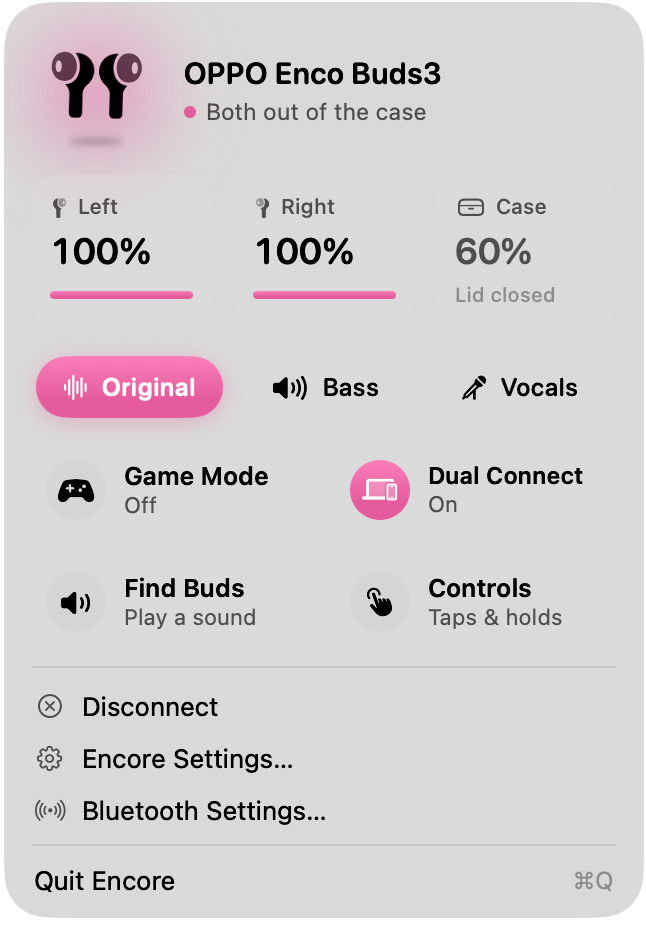
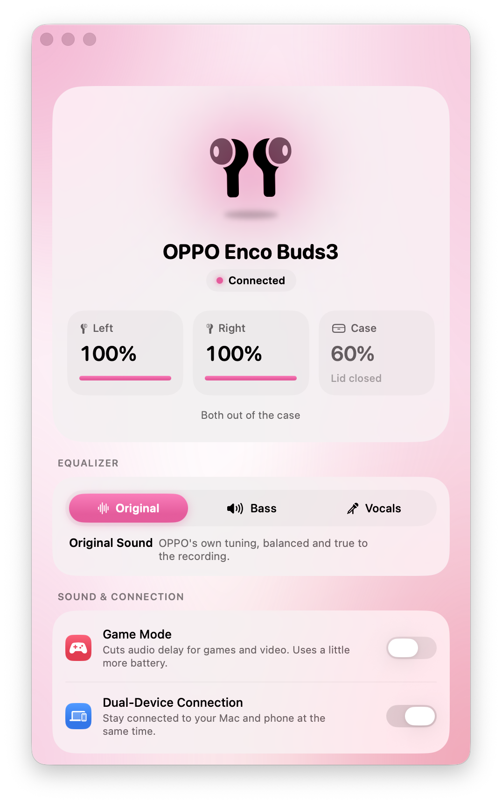
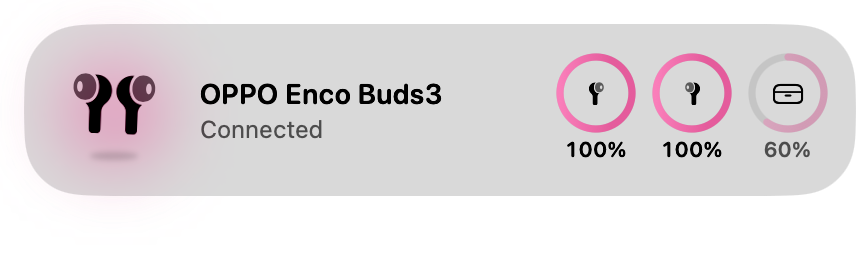

# Encore

A native macOS menu bar app for **OPPO Enco** earbuds. It's like HeyMelody, but built for the Mac with SwiftUI and Liquid Glass, and meant to feel as built-in as AirPods do.

Built and tested with the **OPPO Enco Buds3**. Other OPPO, OnePlus and realme earbuds that work with HeyMelody use the same protocol and should mostly work too.

<p align="center">
  <picture>
    <source media="(prefers-color-scheme: dark)" srcset="docs/screenshots/popover-dark.png">
    
  </picture>
  &nbsp;
  <picture>
    <source media="(prefers-color-scheme: dark)" srcset="docs/screenshots/settings-dark.png">
    
  </picture>
</p>

<p align="center">
  <picture>
    <source media="(prefers-color-scheme: dark)" srcset="docs/screenshots/popup-dark.png">
    
  </picture>
  <br>
  <sub>The menu bar popover, the settings window, and the pop-up you get when your earbuds connect. Encore follows your Mac's accent color and light or dark mode.</sub>
</p>

## Download

### [⬇︎ Download Encore.dmg](https://github.com/d1v4nchik/encore/releases/latest/download/Encore.dmg)

Universal (Apple silicon and Intel) · macOS 26 Tahoe or later

1. Open the DMG and drag **Encore** into **Applications**.
2. Open Encore from Launchpad or Spotlight. It lives in your menu bar.
3. **First launch only:** Encore isn't notarized (that needs a paid Apple developer account), so macOS may say it can't check it for malware. Click **Done**, open **System Settings → Privacy & Security**, scroll down and click **Open Anyway** next to Encore.
4. Click **Allow** when Encore asks to use Bluetooth.

Your earbuds need to be paired in **System Settings → Bluetooth** first.

## Features

- **Battery at a glance:** glass tiles for the left bud, right bud and case (last known levels stay visible, dimmed), plus an optional percentage in the menu bar.
- **Connection pop-up:** a glass card drops in at the top-right when your earbuds connect, like AirPods.
- **Equalizer:** Original Sound, Bass Boost and Clear Vocals presets (Enco Buds3 family).
- **Game Mode:** low-latency mode for games and video.
- **Dual-device connection:** stay connected to your Mac and phone at the same time.
- **Touch controls:** remap tap, double-tap, triple-tap and touch-and-hold on each earbud.
- **Find My Earbuds:** play a loud chirp from both earbuds.
- **Noise control:** off / transparency / ANC, shown only on models that support it.
- **Low battery alerts**, connect and disconnect from the menu bar, and open at login.
- **Diagnostics:** a live log of every packet, plus a probe for discovering new features.

Encore only shows the controls your earbuds actually answer for, so unsupported features don't clutter the UI. EQ is only offered for models with a verified preset table, because the earbuds accept any preset number without checking it.

## Requirements

- macOS 26 (Tahoe) or later, Apple silicon
- Earbuds already paired in **System Settings → Bluetooth**

## Build from source

You don't need Xcode. The Command Line Tools are enough:

```bash
./scripts/build.sh --install
```

This compiles a universal binary with `swiftc`, generates the app icon, ad-hoc signs `Encore.app` and copies it to `/Applications` (or `~/Applications` if that isn't writable). Use `ARCHS=arm64` for a faster single-architecture build.

To make the drag-to-install disk image (`build/Encore.dmg`):

```bash
./scripts/make-dmg.sh
```

`Package.swift` is included too, so `swift build` works on a healthy toolchain.

## How it works

HeyMelody talks to the earbuds over a Bluetooth Classic **RFCOMM** channel. The earbuds advertise it through SDP with the vendor UUID `0000079A-D102-11E1-9B23-00025B00A5A5`. Every frame looks like this:

```
AA  <LEB128 length>  00 00  <command LE16>  <seq>  <payload length LE16>  <payload…>
```

Replies set the command's high bit (`0x0106` battery request → `0x8106` reply). After subscribing with `0x0205`, the earbuds push live updates as `0x0204`.

| Command | What |
| --- | --- |
| `0x0105` | Firmware version |
| `0x0106` | Battery (left / right / case, bit 7 = charging) |
| `0x0108` / `0x0401` | Read / set touch controls |
| `0x0109` | Earbud placement (in case / out) |
| `0x010C` / `0x0404` | Read / set noise control |
| `0x010F` / `0x0406` | Read / set EQ preset (`0x0504` is pushed on change) |
| `0x010D` / `0x0403` | Read / set toggles (Game Mode `0x06`, dual connection `0x11`) |
| `0x0205` | Subscribe to live updates |
| `0x0400` | Find My Earbuds tone |

The code is split in two:

- `Sources/EncoKit` handles Bluetooth: the IOBluetooth RFCOMM transport, the packet codec, the device model and the command queue.
- `Sources/Encore` is the SwiftUI app: the menu bar popover, the settings window and the connection pop-up.

`Sources/EncoKitSelfTest` checks the packet codec against captured frames and runs as part of every build.

The screenshots in `docs/screenshots` come from Encore itself: `Encore --snapshots` photographs its own windows in dark and light mode, saves them to `~/Library/Logs/Encore/Screenshots`, and quits.

## Credits

The protocol details come from public reverse-engineering work:

- [Gadgetbridge](https://codeberg.org/Freeyourgadget/Gadgetbridge)'s OPPO headphone support
- The [oppo-pods](https://github.com/noctalia-dev/community-plugins/tree/main/oppo-pods) plugin for Noctalia, for the product ID list
- [melodyctl](https://github.com/chiragverma11/melodyctl), for HeyMelody's per-model capability table (EQ preset indexes)
- [OP-Buds-4-PC-Controls](https://github.com/Megalodon-sharky/OP-Buds-4-PC-Controls), for the EQ read/set commands
- [Cracking OPOv1](https://aasheesh.vercel.app/blog/oneplus-buds), a write-up on the OnePlus Buds protocol

Encore is an independent implementation.

## Disclaimer

Encore is an unofficial hobby project. It is not affiliated with, endorsed by, or connected to OPPO, OnePlus or realme. "OPPO" and "Enco" are trademarks of their respective owners.

## License

MIT. See [LICENSE](LICENSE).
